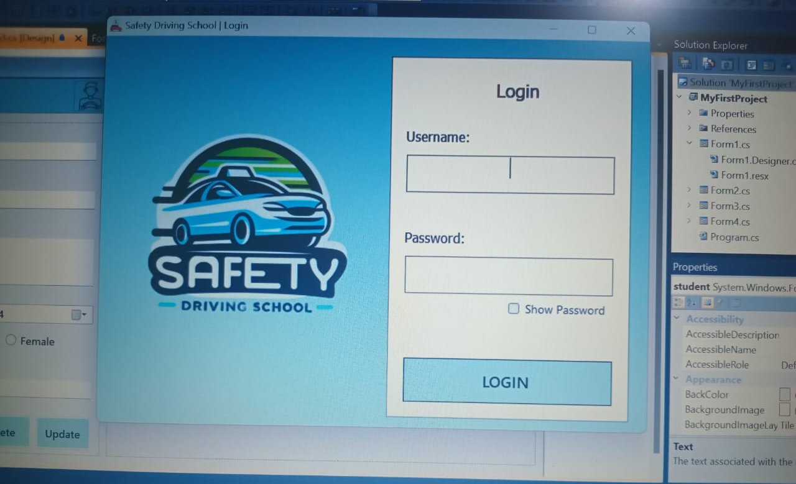
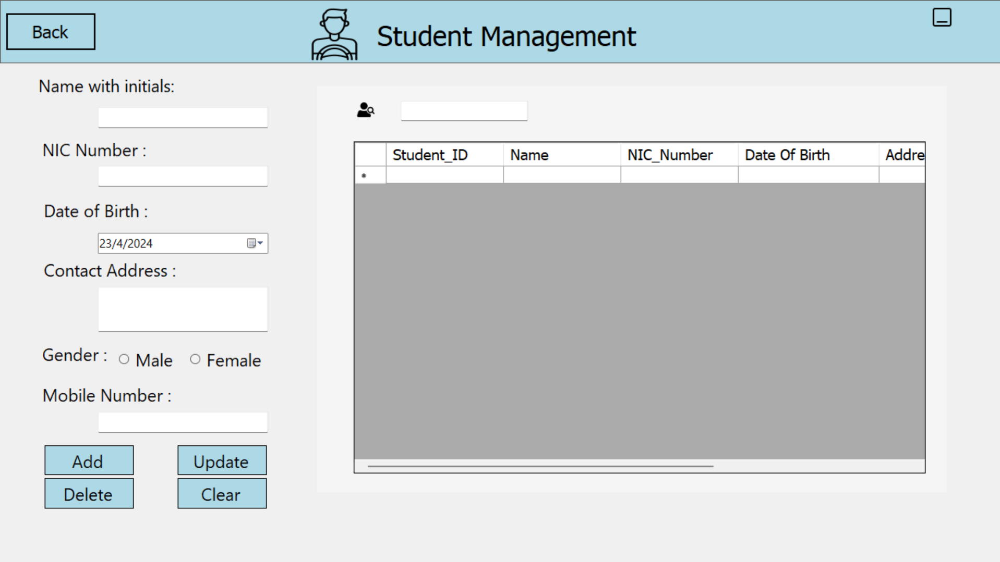
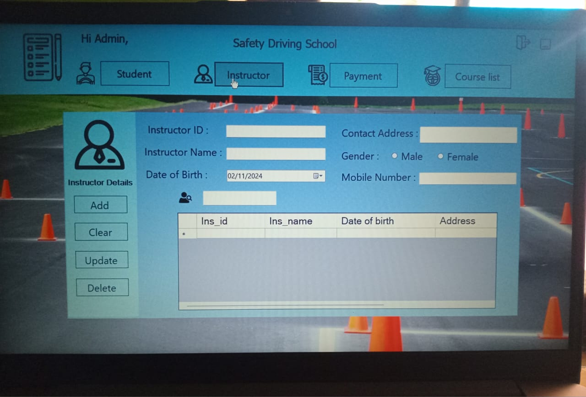
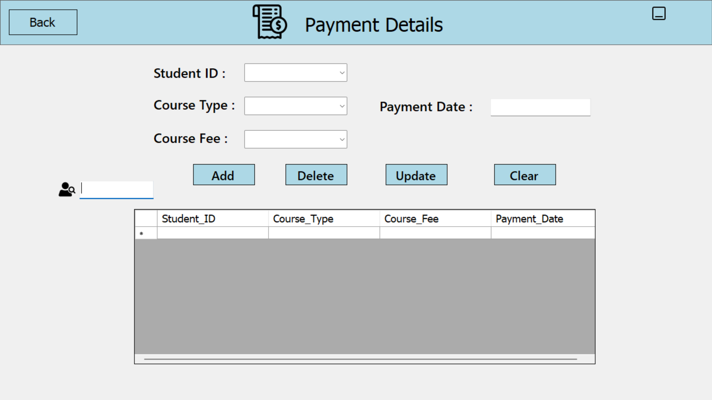
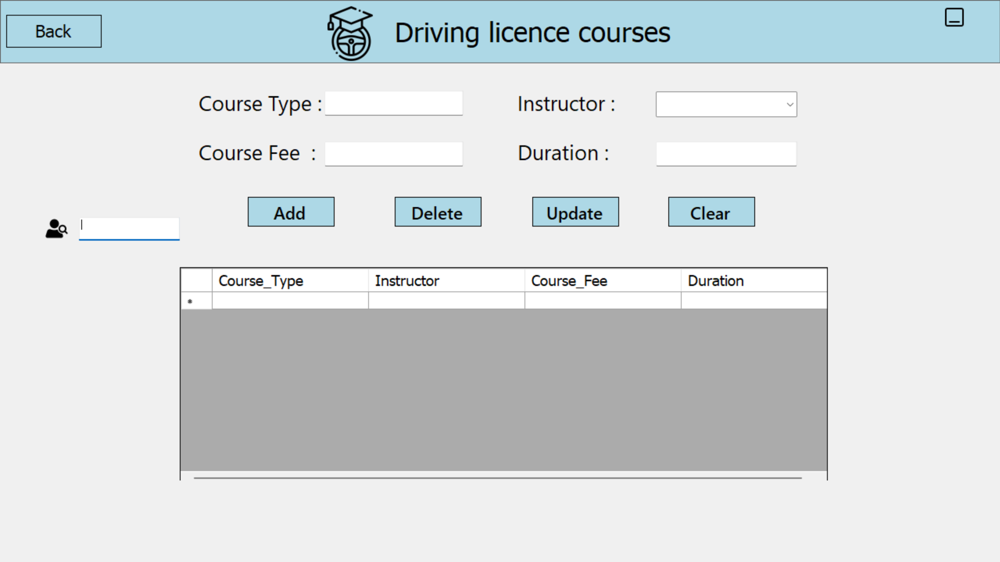

# Driving School Management System

A first-semester academic project developed using C#,
Windows Forms and SQL Server.

## Features
- Basic administrator login
- Student record management
- Instructor record management
- Course and fee management
- Payment record management
- Add, view, update and delete records

## Technologies
- C#
- Windows Forms
- .NET Framework 4.0
- SQL Server Express
- ADO.NET

## Project Status
This is a learning project demonstrating desktop application
development and database CRUD operations.

Known limitations include input validation, error handling,
password visibility, gender selection and payment record targeting.

## Project Screenshots

### Login

### Dashboard

### Student Management

### Instructor Management

### Payment Management

### Course Management

  

## Setup Notes
- Requires Windows and a compatible .NET Framework development environment.
- Open MyFirstProject.sln in Visual Studio.
- The original database file is not included.
- Restore or recreate the database and update the database
  connection strings before running.
